# Privacy-First Offline AI Mobile Agent Using LLM Quantization
### (JARVIS-Like On-Device Intelligent Mobile Assistant)

**Academic Project Title:** *Design and Implementation of a Privacy-Preserving, Quantized On-Device LLM for Autonomous Mobile Task Execution*  
**Department:** Computer Science & Engineering, Delhi Technological University (DTU)  
**Group ID:** DTU/CSE/BTP/GP159  
**Session:** 2026–2027  
**Supervisor:** Ms. Gull Kaur, Assistant Professor, Department of CSE, DTU  

**Authors (Team Members):**
- **Faqre Alam** — Roll No: 23/CS/150 (Lead Systems & Agent Architect)
- **Ekansh Agarwal** — Roll No: 23/CS/149 (Model Optimization & Mobile Inference Lead)
- **Guneet Toppo** — Roll No: 23/CS/160 (Mobile Integrations & Offline Voice Lead)

---

## 1. Project Overview & Core Philosophy

> *"Your personal AI assistant should understand, reason, and perform useful actions directly on your smartphone without leaking a single byte of private data or relying on cloud availability."*

This B.Tech Major Project designs and implements a **100% offline, privacy-first on-device AI assistant** that executes directly on Android smartphones. By combining state-of-the-art **Post-Training Quantization (PTQ/GGUF)** with **Backus-Naur Form (BNF) Grammar-Constrained Decoding**, the assistant autonomously understands natural-language instructions, breaks down multi-step tasks, and executes permitted mobile actions without internet connectivity.

```mermaid
flowchart TD
    User([User Voice / Text]) --> UI[User Interaction Layer\nAndroid UI / Status Feed]
    UI -->|Offline Audio Stream| STT[Offline Speech Engine\nWhisper / Sherpa-ONNX]
    UI -->|Text Input| Agent[Agent Controller & Planner\nReAct Loop & Intent Router]
    STT --> Agent

    subgraph OnDeviceInference [Local Edge Inference Core]
        Agent <--> LLM[llama.cpp GGUF Core\nLlama-3.2 / Qwen2.5]
        LLM <--> BNF[BNF Grammar Sampling\n100% Valid JSON Function Calls]
    end

    Agent -->|Structured Tool JSON| Gate[Security & Confirmation Gate\nZero-Trust Sandbox]
    Gate -->|Execute Safe Tool| OS[Mobile OS API Layer\nCalendar, Reminders, Notes, Docs, SMS]
    OS --> Results[Result Verification]
    Results --> Agent
    Agent --> TTS[Android Native TTS / Audio Feedback]
    TTS --> UserFeedback([Spoken & Visual Output])

    style OnDeviceInference fill:#0d261d,stroke:#00c08b,stroke-width:2px
    style Gate fill:#1e293b,stroke:#e6b800,stroke-width:2px
```



---

## 2. Research Problem & Theoretical Novelty

### The Limitations of Cloud Assistants
1. **Zero-Trust Privacy Violation:** Commercial assistants (Siri, Google Gemini, ChatGPT) transmit personal conversations, local file contents, and schedules to remote servers.
2. **Connectivity Fragility:** Assistants fail completely in airplanes, subways, remote field work, or during outages.
3. **Execution Gap:** Cloud LLMs generate conversational advice rather than autonomously executing device actions.
4. **Latency & Recurring Cost:** Network roundtrips add 1.5–4.0s delay alongside recurring API billing.

### The Edge Computing Challenge & Our Solution
Compact Small Language Models ($<2\text{B}$ parameters) subjected to 4-bit quantization suffer severe **structural syntax collapse**, emitting broken JSON and invalid arguments.  
**Our Core Solution:** We integrate **Grammar-Constrained Decoding (GBNF Grammars)** into the local sampling loop. This forces logits through a finite-state machine that guarantees **100% syntactically valid tool calls** even on aggressive 4-bit quantized models (`Q4_K_M`, `Q4_0`).

---

## 3. The 6 Core Mobile Tools

The assistant operates within a strict permission-controlled mobile sandbox:

| Tool Identifier | Functionality | Mobile API / Subsystem | Security Level |
|---|---|---|:---:|
| `create_reminder` | Schedule timed alarms & system notifications | Android `AlarmManager` | **SAFE** |
| `search_calendar` | Query calendar schedule & check free slots | Android `CalendarProvider` | **SAFE** |
| `manage_notes` | Full CRUD operations for personal notes | Local `Room` Database (SQLite) | **SAFE** |
| `search_local_docs` | Search authorized local PDF / TXT files | Scoped Storage (`READ_MEDIA_DOCS`) | **SAFE** |
| `read_document_summary` | Chunk & extract semantic context from files | Local Offline RAG Engine | **SAFE** |
| `draft_message` | Prepare pre-filled SMS or WhatsApp drafts | Android Intent (`ACTION_SENDTO`) | **REQUIRES CONFIRMATION** |

---

## 4. Repository Structure

```
.
├── NEW_PROJECT_BUILD_PLAN.md      # Comprehensive Architectural Master Plan
├── README.md                      # This file
├── mobile_agent/                  # Core Python/Android Agent Engine
│   ├── __init__.py
│   ├── cli.py                     # Interactive offline terminal assistant
│   ├── core/
│   │   └── agent.py               # ReAct controller, prompt builder, context manager
│   ├── grammar/
│   │   └── tool_calling.gbnf      # GBNF sampling grammar forcing 100% valid JSON
│   ├── storage/
│   │   └── db.py                  # Offline SQLite storage (mirroring Android Room DB)
│   └── tools/
│       ├── handlers.py            # Concrete handlers for the 6 core mobile tools
│       ├── registry.py            # Validation, security confirmation gates, dispatch
│       └── schemas.py             # Formal JSON schemas & permission definitions
├── ppt/                           # Presentation & Viva Defense Materials
│   ├── index.html                 # 13-slide interactive dark-mode presentation deck
│   ├── PRESENTATION_GUIDE_AND_VIVA_QA.md # Spoken scripts & comprehensive Viva Q&A
│   └── presentation_guide_and_viva_qa.tex # Complete academic LaTeX documentation
├── tests_agent/
│   └── test_agent_system.py       # Automated unit & integration test suite (100% passing)
└── archive/                       # Archived Phase 1 research materials
    └── legacy_evaluation_phase/
```

---

## 5. Quick Start: Try the Offline Assistant

You can run and interact with the offline agent immediately via the interactive CLI:

```bash
# Run the interactive JARVIS offline terminal assistant
python3 -m mobile_agent.cli
```

### Example Commands in CLI:
- `Remind me to call Rahul tomorrow at 10 am` *(Invokes reminder tool)*
- `Check my schedule for tomorrow` *(Searches calendar database)*
- `Draft a note titled Study Session` *(Writes to local SQLite notes)*
- `Find my project proposal PDF and summarize it` *(Performs local document search & extraction)*
- `Draft a WhatsApp message telling Rahul that I will be late` *(Triggers the security confirmation gate)*
- Interactive commands: `/tools`, `/notes`, `/reminders`, `/audit`, `/clear`, `/exit`

### Run Automated Unit Tests:
```bash
python3 -m unittest tests_agent/test_agent_system.py
```

---

## 6. Team Workload Division (DTU GP159)

| Team Member | Roll No | Primary Role & Core Technical Ownership |
|---|:---:|---|
| **Faqre Alam** | 23/CS/150 | **Lead Systems & Agent Architect:** Agent controller, ReAct loop, BNF grammar-constrained JSON engine, prompt schemas, and Android UI orchestration. |
| **Ekansh Agarwal** | 23/CS/149 | **Model Optimization & Mobile Inference Lead:** GGUF quantization pipeline (`Q8_0`, `Q4_K_M`, `Q4_0`), `llama.cpp` Android C++/NDK integration, KV-cache management, and battery/thermal profiling. |
| **Guneet Toppo** | 23/CS/160 | **Mobile Integrations & Offline Voice Lead:** Android OS API handlers (Calendar, AlarmManager, Room Notes, Scoped Storage PDF parser), and offline STT/TTS voice pipeline. |
